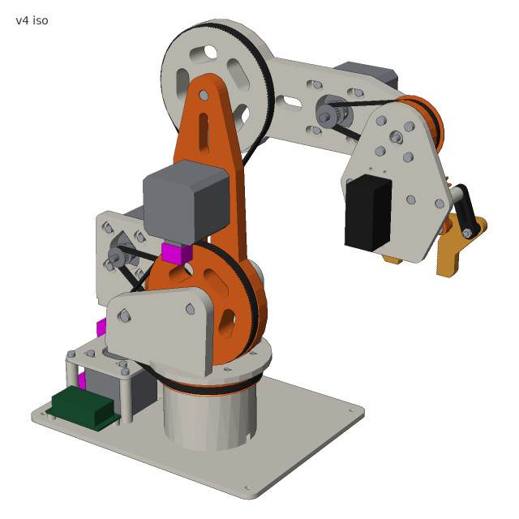

# 24-Hour Robot Arm

A 4-axis, belt-driven desktop robot arm with a parallel-jaw gripper. Every structural part is 3D printed in PLA, it is built around stepper motors and an Arduino Uno + CNC Shield that were already on hand, and the parts to buy come to under $100 on Amazon US.

| | |
|---|---|
| Axes | Yaw, shoulder, elbow, wrist (NEMA 17 steppers) + servo gripper |
| Reach | ~287 mm at the table with the gripper pointing down, 375 mm stretched out (computed) |
| Payload | 300 g target; ~130 g inside a 50 % torque margin, 300 g holds statically (computed, bench test pending) |
| Drive | GT2 belts with printed pulleys: yaw 6:1, shoulder 14:1 (two-stage), elbow 7:1, wrist 3:1 |
| Gripper | MG996R servo driving geared cranks and a parallelogram linkage, so the jaws translate without rotating; ~51 mm opening |
| Controller | Arduino Uno R3 + CNC Shield V3, 4× A4988, 24 V supply, XL4015 buck for the servo |
| Printed parts | ~500 g PLA, sliced for a 256 mm bed (Bambu Lab X1E) |

The figures above come from the CAD and the scripts in [`sim/`](sim/). They are estimates until the arm is assembled and tested on the bench.

## Status

Design v4 has passed its assembly, interference and print checks, and the print files are sliced. Still to verify on hardware: the MG996R horn dimensions (measure before printing the gripper parts), printed gear backlash, grip force and payload. [`design/v4/summary.md`](design/v4/summary.md) lists every open item.

## Repository layout

| Path | Contents |
|---|---|
| [`brief.md`](brief.md), [`requirements.yaml`](requirements.yaml) | The original brief and the numeric targets |
| [`decisions.md`](decisions.md) | Design decisions and the reasons for them |
| [`design/v4/`](design/v4/) | **Current design**: build123d sources for every printed part (`printed/*.py`), STLs, the assembly (`assembly.yaml`, `assembly.glb`), poses, renders, the print list and the print plate layouts (`gcode/`) |
| `design/v1`–`v3` | Earlier iterations, kept for reference |
| [`firmware/`](firmware/) | Arduino sketches: `arm_v4` (current), `motor_test`, older versions |
| [`hw/`](hw/) | Wiring, driver and motor configuration (`wiring.yaml`, `drivers.yaml`, `motors.yaml`) |
| [`parts/`](parts/) | Bill of materials (`components.yaml`), build plan, compatibility checks, 3D models of bought parts (`models/`) |
| [`docs/`](docs/) | Assembly guide (Markdown and PDF), bring-up and calibration, screw list, Amazon cart |
| [`sim/`](sim/) | Torque, reach, yaw-sweep and gripper-motion checks |
| [`tools/`](tools/) | Serial motor bridge and helper scripts |
| [`research/`](research/), [`inspiration/`](inspiration/) | Part research, prior-art notes, reference photos and design redlines |
| [`windows/`](windows/), [`viewers/`](viewers/) | Browser views used during design (CAD viewer, motor test, microstep jumper guide) |
| [`.mechy/reviews/`](.mechy/reviews/) | Independent design and pre-order reviews |

## Build it

1. **Buy the parts.** [`docs/amazon-cart.md`](docs/amazon-cart.md) lists the 10 items (~$88). [`parts/build_plan.md`](parts/build_plan.md) lists every function, including the parts that were already owned (steppers, Uno, CNC shield, drivers, 24 V supply, thrust bearing).
2. **Print.** Print the fit coupon first and check the bearing and screw fits ([assembly guide, step 1](docs/assembly-guide.md)). Then print the arm plates. Ready-to-print Bambu Lab X1E G-code is attached to the [latest release](../../releases/latest). For another printer, slice the STLs in [`design/v4/printed/`](design/v4/printed/) with the settings in [`design/v4/gcode/README.md`](design/v4/gcode/README.md) (0.20 mm layers, 4 walls, 20 % gyroid, no supports). Hold the gripper parts until you have measured your servo.
3. **Assemble.** Follow [`docs/assembly-guide.md`](docs/assembly-guide.md) ([PDF](docs/assembly-guide.pdf)), with screws from [`docs/screw-list.md`](docs/screw-list.md).
4. **Wire and bring up.** Follow [`docs/bring-up.md`](docs/bring-up.md): check the shield capacitor rating, set Vref on each A4988, set the microstep jumpers and set the buck output **before** you connect the servo.
5. **Flash.** Open `firmware/arm_v4/arm_v4.ino` in the Arduino IDE (board: Arduino Uno) and upload it. The arm talks over serial at 115200 baud. The command set is documented at the top of the sketch.

> **Safety:** the arm runs on 24 V and steppers hold with real force. Keep the supply within reach to unplug it, never power the servo from the Uno's 5 V pin, and insert the A4988 drivers the right way round (a reversed driver is destroyed).

## Regenerating the CAD

Parts are modelled in Python with [build123d](https://github.com/gumyr/build123d). Some scripts (`tools/mpy.py`, `tools/start_bridge.py`, `parts/models/fasteners.py`) expect the Python environment and standard-parts data of the Mechy design tool, which was used to build this project. Change the paths at the top of those files to point at your own build123d environment.

## Acknowledgements

Prior art studied for this design is listed in [`inspiration/links.yaml`](inspiration/links.yaml), with notes in [`inspiration/notes/`](inspiration/notes/). Third-party pages, vendor product photos and datasheets were consulted but are not redistributed here. Follow the source links in `parts/` and `research/` instead.

## License

[MIT](LICENSE)
