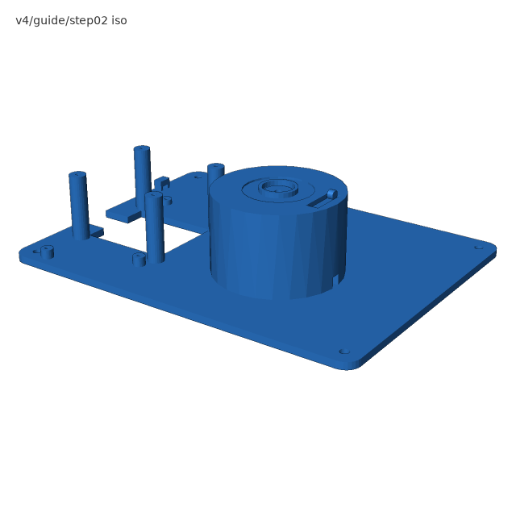
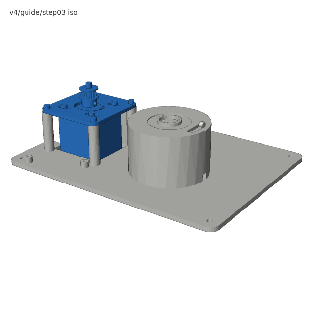
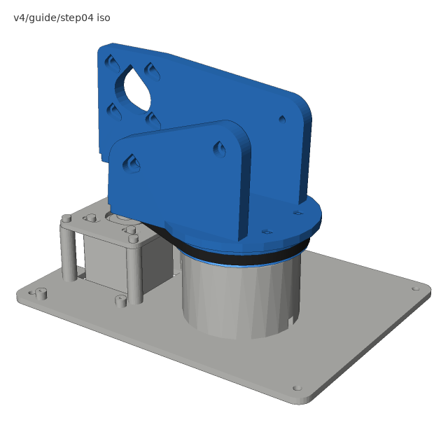
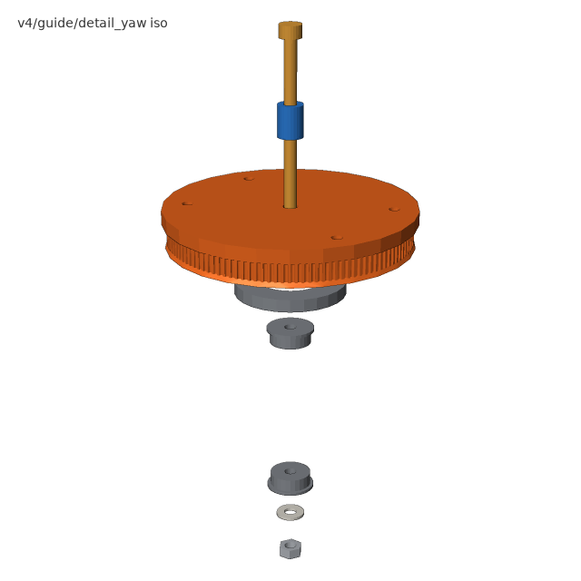
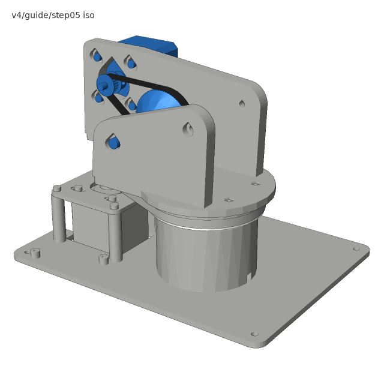
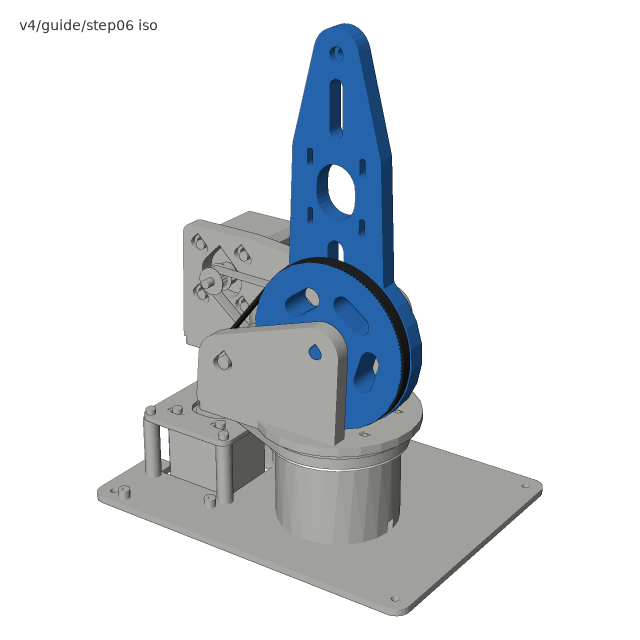
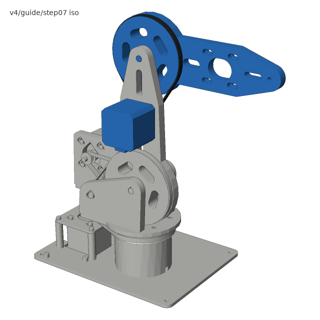
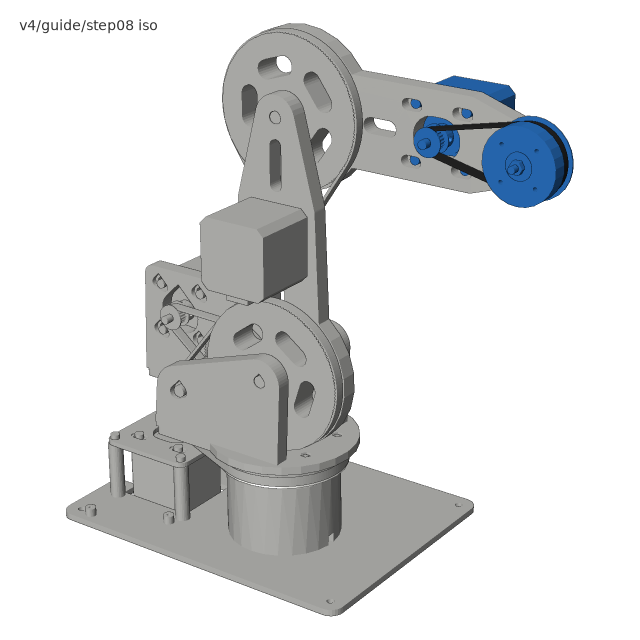
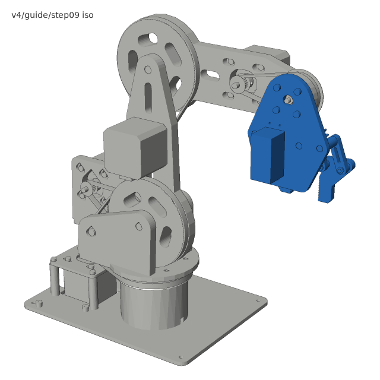
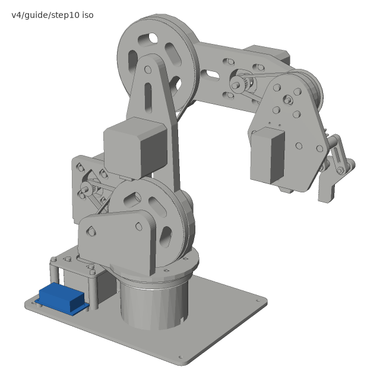

# v4 robot arm: assembly guide

Each picture shows the arm after the step: **parts added in that step in blue, earlier parts grey**. Printed parts and hardware come from design/v4 (print plates in design/v4/gcode). Wiring is in the Electronics view (hw/wiring.yaml); power-up and calibration in docs/bring-up.md.

Tools: 2.5 and 3 mm hex keys, small screwdriver, multimeter, soldering iron, super glue, calipers.

## Step 1: Check the fits first

1. Print the fit coupon (coupon plate) before the arm plates.
2. Press an F624ZZ into each Ø12.9-13.2 pocket by thumb: pick the size that holds the bearing without a vice. The parts are printed at 13.1.
3. Push an M4 bolt through the 4.0-4.3 holes and an M3 through 3.4/3.6, and drive an M3 into the 2.4/2.6 pilots.

> **Caution:** If 13.1 is loose or too tight, stop: the plates get re-sized and re-sliced first.

## Step 2: Base: bearings, washer and yaw switch

**Printed:** base, yaw-race-washer

**Hardware:** 2 x F624ZZ bearing, 1 x race washer 1 mm

1. Press the top F624ZZ into the boss from above, flange up (flush with the AXK seat).
2. Press the bottom F624ZZ from underneath, flange down against its shoulder.
3. Solder two wires to the KW12-3's C and NO lugs, feed them down the slot and glue the switch upright in its pocket (roller up).

> **Caution:** Both bearings press in by hand; never hammer PLA.

## Step 3: Yaw motor

**Printed:** yaw-motor-plate

**Hardware:** 1 x GT2 20T pulley, 4 x M3 x 6, 4 x M3 x 16

1. Slide a GT2 20T pulley on the yaw motor shaft, hub toward the motor, 0.5 mm above the plate; tighten the set screws on the shaft flat.
2. Screw the motor face-up under the 3 mm yaw plate: 4 x M3 x 6 through the slots (heads in the counterbores).
3. Lower the motor through the base floor cut-out (it stands on the table) and screw the plate to the 4 posts: 4 x M3 x 16. Leave the slot screws loose for belt tension.

> **Caution:** The motor plug faces the -x edge: it exits through the floor opening.

## Step 4: Thrust bearing, yaw pulley, turret

Yaw axle, exploded (turret left out): M4 x 70 (gold) -> spacer (blue, sits in the deck's centre hole) -> yaw pulley -> AXK2035 -> top bearing -> base -> bottom bearing -> race washer -> M4 nut.

**Printed:** turret, yaw-bolt-spacer, yaw-pulley

**Hardware:** 1 x 320 mm belt, 1 x M4 x 70, 1 x M4 nut, 4 x M3 x 10, 4 x M3 nut

1. Drop 4 M3 nuts into the deck traps from the top of the turret.
2. Screw the 120T yaw pulley under the deck: 4 x M3 x 10 from the pulley side into the nuts.
3. Lay the AXK2035 (washer, cage, washer) on the base seat around the centring ring.
4. Loop a 320 mm belt round the yaw pulley, set the turret on the AXK and hook the belt over the motor pulley.
5. Drop the printed 8 x 10 mm yaw bolt spacer into the deck's centre hole, then push an M4 x 70 down through it, the pulley, the AXK and both bearings; add the race washer and the M4 nut from underneath, snug (the turret must still turn freely, and the bolt tip stays above the table).
6. Slide the yaw motor out in its slots until the belt is taut, then tighten the plate screws.

> **Caution:** Tension: the belt should deflect ~3 mm under a firm finger press, no more.

## Step 5: Shoulder motor and intermediate pulley

**Printed:** i-washer-left, i-washer-right, sh-compound, spacer-i, spacer-i-2

**Hardware:** 1 x GT2 20T pulley, 1 x 200 mm belt, 4 x M3 x 10, 1 x M4 x 70, 1 x M4 nut, 2 x race washer 1 mm, 2 x F624ZZ bearing

1. Pulley on the shoulder motor shaft (2.5 mm from the tower face), then screw the motor to the right tower's outer face: 4 x M3 x 10 through the slots, heads in the counterbores on the inner face. Leave them loose.
2. Press an F624ZZ into each end of the 72T/36T compound pulley, flanges out; slide the two 20 mm spacer tubes inside.
3. Loop a 200 mm belt over the compound's 72T and set the compound between the towers on the I slot.
4. M4 x 70 through the left tower (head in the counterbore), race washer, compound, race washer, right tower; M4 nut in the right tower's slot. Hand-tight for now.
5. Hook the 200 mm belt over the motor pulley and slide the motor along its slots until taut; tighten.

> **Caution:** Set the motor pulley before fitting the motor: its set screws can't be reached later.

## Step 6: Lower shank on the shoulder axle

**Printed:** lower-shank, s-washer-left, s-washer-right, spacer-ls, spacer-s

**Hardware:** 1 x 320 mm belt, 1 x M4 x 70, 1 x M4 nut, 2 x race washer 1 mm, 2 x F624ZZ bearing

1. Press an F624ZZ into each face of the lower shank hub; put the 8 mm spacer tube inside.
2. Loop a 320 mm belt over the compound's 36T and over the lower shank's 140T teeth.
3. M4 x 70 through the left tower, race washer, lower shank hub, 32 mm spacer, race washer, right tower; nut in its trap. Tighten until the shank turns freely without play.
4. Slide the I axle along its slot to tension the 320 mm belt, then tighten the I nut.

> **Caution:** The shoulder has no self-locking: support the shank by hand until the motors are powered.

## Step 7: Elbow motor and upper shank

**Printed:** e-washer-1, e-washer-2, spacer-e, upper-shank

**Hardware:** 1 x GT2 20T pulley, 1 x 320 mm belt, 4 x M3 x 8, 2 x F624ZZ bearing, 1 x M4 x 30, 2 x race washer 1 mm, 1 x M4 nut

1. Pulley on the elbow motor shaft (1.4 mm from the plate), then screw the motor to the lower shank's -y face: 4 x M3 x 8 through the slots, heads in the counterbores. Loose.
2. Press an F624ZZ into each side of the upper shank's elbow hub, 7 mm spacer inside.
3. Loop a 320 mm belt over the upper shank's 140T and the elbow motor pulley.
4. M4 x 30 through the lower shank (head in the counterbore), race washer, upper shank hub, race washer, M4 nut.
5. Slide the elbow motor along the shank until the belt is taut; tighten.

## Step 8: Wrist motor and wrist pulley

**Printed:** spacer-w, wrist-flange, wrist-pulley, wrist-washer

**Hardware:** 1 x GT2 20T pulley, 1 x 200 mm belt, 4 x M3 x 8, 1 x M4 x 30, 1 x wrist washer 1.7 mm, 2 x F624ZZ bearing, 1 x M4 nut

1. Glue the flange ring onto the toothed face of the wrist pulley (super glue), centred over the bearing.
2. Pulley on the wrist (HEM) motor shaft 1.3 mm out from the shank, then screw the motor to the upper shank's +y face: 4 x M3 x 8, slots loose.
3. Press an F624ZZ into each face of the wrist pulley, 5.3 mm spacer inside.
4. Loop a 200 mm belt over the wrist pulley and the motor pulley.
5. M4 x 30 through the upper shank (head in the counterbore), the 1.7 mm wrist washer, the wrist pulley, M4 nut.
6. Tension with the motor slots and tighten.

> **Caution:** The 1.7 mm washer is the thick one; the eight 1 mm race washers go elsewhere.

## Step 9: Gripper (after the servo is measured)

**Printed:** crank-gear-a, crank-gear-b, gripper-base, idler-link-a, idler-link-b, jaw-a, jaw-b

**Hardware:** 3 x M3 x 30, 7 x M3 nut, 4 x M3 x 20, 4 x M3 x 16

1. Print the gripper plate only after the servo measurements (docs/servo-measure.md).
2. Servo into the gripper base window, body toward the jaws: 4 x M3 x 10 into the tab pilots.
3. Gear B and both idler links on their M3 x 30 pivots from the base's bed face, nuts on top left just free (thread glue).
4. Centre the servo (GRIP 50 from the firmware), then screw crank gear A to the horn with the horn screws so its teeth mesh with B and both cranks point the same way.
5. Jaws onto the crank and idler pins: M3 x 20, nuts underneath, just free.
6. Screw the gripper base to the wrist pulley: 4 x M3 x 16 self-tapping.

> **Caution:** Turn the gears by hand through the full stroke before powering: nothing should bind.

## Step 10: Electronics

1. Screw the Uno to its 4 posts (M3 x 8) and the XL4015 to its 2 posts.
2. Fit the A4988s (EN to EN), the microstep jumpers and the two A-axis jumpers; set Vref (docs/bring-up.md).
3. Wire everything as in the Electronics view (hw/wiring.yaml); set the buck to 6.3 V before the servo plugs in.
4. Tie the cables at the base's -x edge, leave a ~0.5 m loop up to the arm, and turn the yaw by hand through -150..150 to check nothing snags.

> **Caution:** Never power the servo from the Uno's 5 V; unplugging the 24 V jack is the e-stop (lower the arm first).
